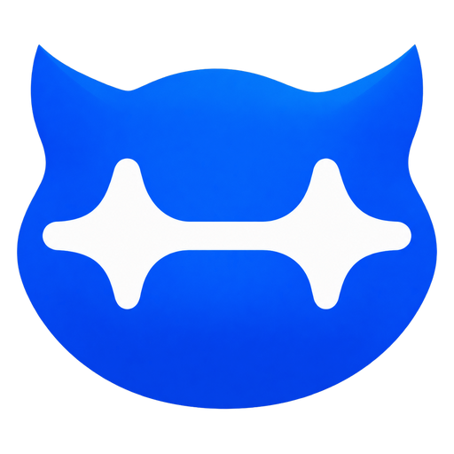

<p align="center"></p>

# Sonic

A native Plex and local music player built with Rust, Slint, and Rodio. Browse albums, manage your queue and playlists, tune the equalizer, and connect Discord Rich Presence or Last.fm.

## Features

- **Library:** Plex and local files in one album grid with search, sorting and grouping. Click an album to see its songs in the sidebar, double-click to play, right-click for Add to queue, Shuffle play or Add to playlist.
- **Queue:** grouped by album, drag to reorder, and Clear queue keeps the current song playing.
- **Playlists:** create, rename, reorder and remove tracks, add a custom cover, or let Sonic tile the first four albums as the cover.
- **Now Playing:** full-window cover with synced lyrics that follow the song and can be clicked to jump. Lyrics come from a `.lrc` file next to a local track, lyrics embedded in the file, or [LRCLIB](https://lrclib.net). The online lookup sends only the title, artist, album and length, and can be turned off in **Settings → Playback**.
- **Playback:** gapless playback, a 20-band EQ with loudness normalization and preamp, live level bars on the playing track, and pop-free seeking.
- **Windows media controls:** media keys and the system media flyout (with cover art) work as soon as a track is loaded.
- **Look:** themes from a chosen color or from the playing album's art, kept dark and subtle.

## Run on Windows

Open a successful [Windows build](https://github.com/blinkywink/sonic-player/actions/workflows/build.yml) and download the `sonicplayer-windows-x64` artifact. Extract it and run `sonicplayer.exe`.

- **Plex:** Open **Settings → Library → Sign in with Plex**, approve Sonic in your browser, then return to the app.
- **Local music:** Enable local files in **Settings → Library**, put music in the `SonicMusic` folder, and refresh. You can also pass audio file paths when launching Sonic.
- **Discord and Last.fm:** Both are under **Settings → Tracking**. Discord uses an Application ID and an optional image asset key. Last.fm uses an API key and secret, followed by browser approval.

On Windows, the Sonic tray menu has **Open Sonic**, **Run at startup**, and **Quit**. Closing the window keeps the player in the tray.

## Build from source

On Windows, install the Rust MSVC toolchain and Visual Studio C++ Build Tools with a Windows SDK. From the repository root:

```powershell
cargo build --release --locked --manifest-path native/Cargo.toml
cargo test --release --locked --manifest-path native/Cargo.toml
```

The executable is at `native/target/release/sonicplayer.exe`. Windows is the verified build target. macOS and Linux still need runtime verification.

The [previous Electron client](https://github.com/blinkywink/sonic-player/tree/80a1ecb) is available in Git history.
